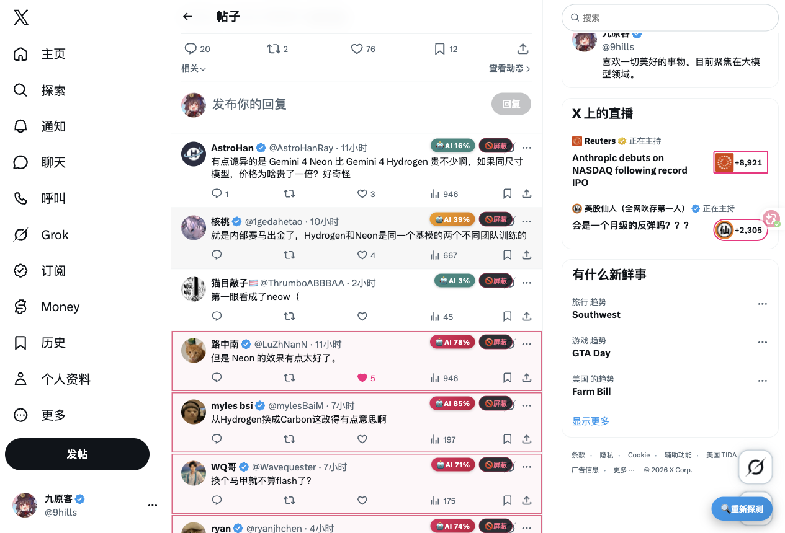
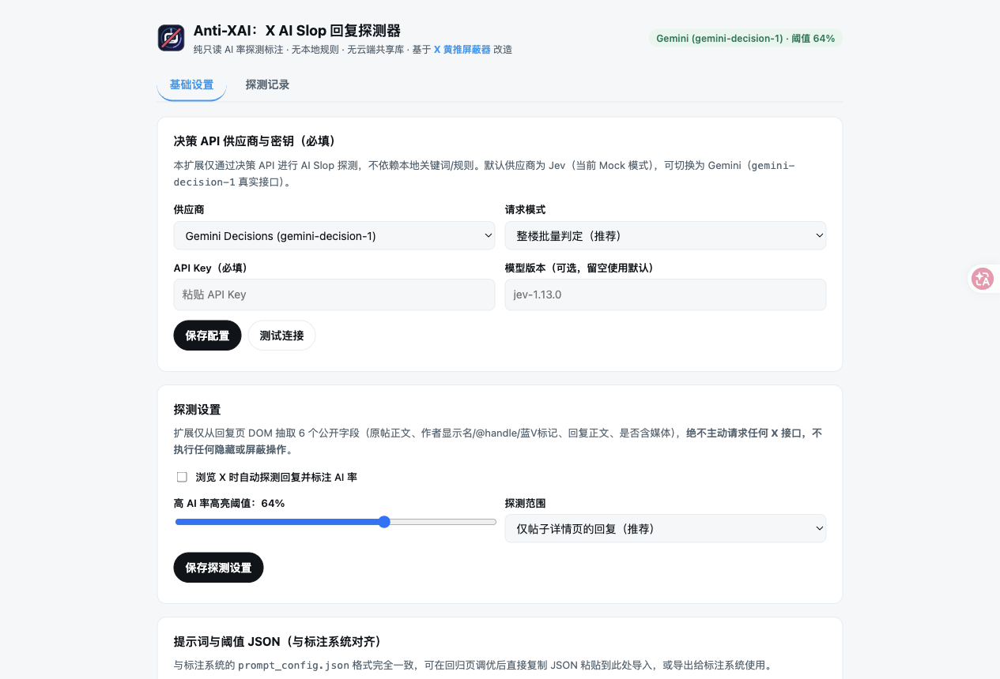
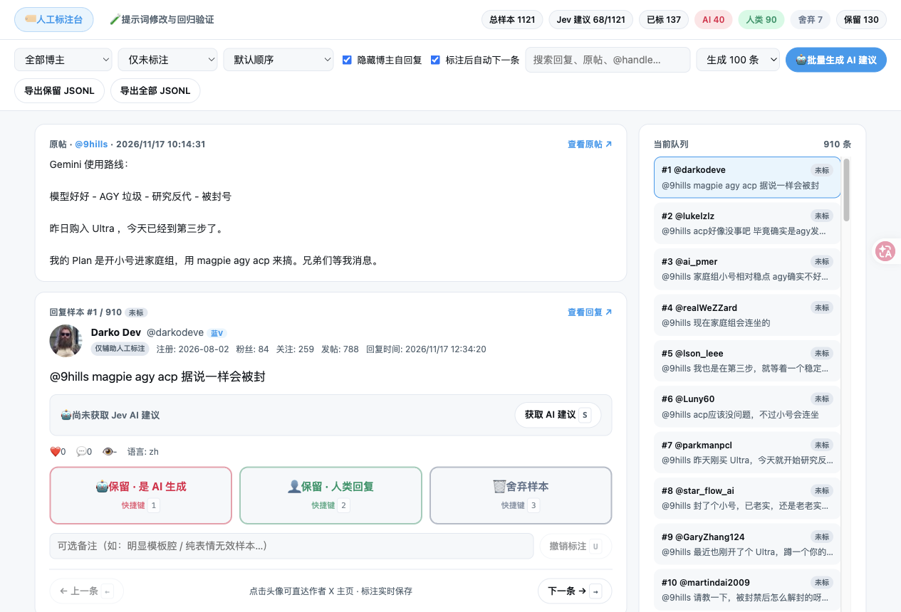
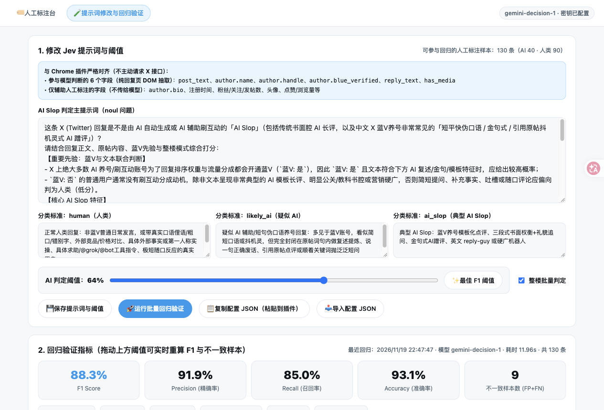

# Anti-XAI：X (Twitter) 回复 AI Slop 探测器

> **项目状态提示**：本项目为试验性项目，后续不会开发和维护，请各位参考。
>
> **模型提示**：本项目所有实测、提示词调优与回归评估均基于 **`gemini-decision-1`**（Google Gemini Decisions API）完成，**请使用 `gemini-decision-1` 模型**（Jev 默认接口未做实测验证）。
>
> **来源与免责声明**：本项目的 Chrome 扩展基于 [**X 黄推屏蔽器**](https://chromewebstore.google.com/detail/x-%E9%BB%84%E6%8E%A8%E5%B1%8F%E8%94%BD%E5%99%A8/paaidifphnonojfblgioamenkigglhed)（ID: `paaidifphnonojfblgioamenkigglhed`）二次改造而来，**未经原作者授权**；如原作者认为不妥或要求下架，本仓库可随时删除。
>
> **准确率声明**：目前仅依据**单条回复**及当前页面可见信息很难准确识别所有 AI 账号，真正可靠的判定需要结合**账号级别的历史全部回复**进行综合分析；因此本工具给出的 AI 率打分与结论**仅供参考**，请自行判断后再决定是否屏蔽。

基于决策 API（支持 **Jev** 与 **Google Gemini Decisions `gemini-decision-1`**）探测 X 帖子回复区的 AI Slop（低质 AI 刷评 / 蓝V养号评论）。

- **防封号设计**：插件**绝不主动请求任何 X 接口**，仅从回复页 DOM 抽取 6 个字段（`post_text`、`author.name`、`author.handle`、`author.blue_verified`、`reply_text`、`has_media`）；不自动隐藏或批量屏蔽，仅在每条回复右上角标注 AI 率并提供单条「🚫 屏蔽」按钮（通过页面原生菜单点击完成）。
- **无本地规则 / 无云端共享库**：完全依赖你自行配置的决策 API 密钥。
- **插件与标注系统严格对齐**：共用同一份 `prompt_config.json` 与完全一致的输入格式。



---

## 一、手动安装 Chrome 插件

1. 在 Chrome 地址栏打开 `chrome://extensions/`。
2. 打开右上角的 **开发者模式**。
3. 点击左上角 **加载未打包的扩展程序**，选择本仓库下的 `anti-xai-ext/` 目录即可完成安装。

## 二、配置与使用插件

1. 安装后会自动打开欢迎页，或点击扩展图标进入 **设置**。
2. 在 **决策 API 供应商与密钥** 中选择供应商：
   - **Jev（默认）**：直连默认官方地址 `https://api.typesafe.ai/v1/systemone`（也支持自定义地址），填入你的 Jev API Key。
   - **Gemini Decisions (`gemini-decision-1`)**：填入你的 Google AI Studio `GEMINI_API_KEY`，点击 **保存配置** 与 **测试连接**。
3. 打开任意 `x.com` 帖子详情页，回复右上角会自动打出 `🤖 AI xx%` 徽章（默认阈值 `64%`，高于阈值标红高亮）：
   - 点击单条回复旁的 **「🚫 屏蔽」** 可通过页面原生菜单屏蔽该账号；
   - 点击右下角 **「🔍 重新探测」** 可重新扫描当前页回复。



---

## 三、人工标注数据集

本仓库自带轻量级本地标注台（纯 Python 3 标准库，零外部依赖）。

1. 复制环境模板并填入你的 API Key：
   ```bash
   cp labeler/.env.example labeler/.env
   # 编辑 labeler/.env，填入 JEV_URL / JEV_API_KEY / JEV_MODEL
   ```
2. 启动标注服务：
   ```bash
   python3 labeler/server.py --port 8765
   ```
3. 浏览器访问 `http://127.0.0.1:8765/`：
   - 顶部可选择生成条数（默认 `100` 条）并点击 **「🤖 批量生成 AI 建议」**，或按 `S` 对当前条单独获取建议；
   - 快捷键快速标注：`1` 保留·AI 生成 / `2` 保留·人类回复 / `3` 舍弃样本 / `U` 撤销 / `←` `→` 切换上下条；
   - 点击作者头像或 `@handle` 可直接跳转其 X 主页；
   - 标注结果实时保存至 `dataset/labels.json` 与 `dataset/labeled.jsonl`，支持一键导出。

> 标注页中展示的作者简介、注册时间、粉丝数、点赞/浏览量等字段已标记为「仅辅助人工标注」，**不会传给模型**，以保证与插件纯 DOM 抽取维度严格一致。



---

## 四、迭代 Prompt 与回归验证

1. 打开 `http://127.0.0.1:8765/regression` 进入 **提示词修改与回归验证** 页面：
   - 修改 AI Slop 判定主提示词或三分类标准，点击 **「🚀 运行批量回归验证」**，系统会对所有人工标注为「保留」的样本批量打分并计算 **F1 / Precision / Recall / Accuracy / 混淆矩阵**；
   - 拖动 **AI 判定阈值** 滑块或点击 **「✨ 最佳 F1 阈值」**，可在不重跑 API 的情况下实时重算指标并拉出全部 **FP 误报 / FN 漏报** 样本；
   - 调优完成后，点击 **「📋 复制配置 JSON（粘贴到插件）」**，粘贴到 Chrome 扩展设置页的「提示词与阈值 JSON」框中点击导入即可同步生效。



2. 历史提示词版本均保存在 `prompts/` 目录（`v1.json` ~ `v5.json`），也可以用命令行脚本直接对任意版本做离线回归评估：
   ```bash
   python3 prompts/eval_prompt.py prompts/v5.json
   ```

| 版本 | ROC-AUC | 最佳阈值 | F1 | Precision | Recall | Accuracy |
|---|---:|---:|---:|---:|---:|---:|
| `prompts/v1.json` | 0.7900 | 0.25 | 67.42% | 61.22% | 75.00% | 77.69% |
| `prompts/v2.json` | 0.9172 | 0.55 | 79.12% | 70.59% | 90.00% | 85.38% |
| `prompts/v3.json` | 0.9167 | 0.35 | 79.55% | 72.92% | 87.50% | 86.15% |
| `prompts/v4.json` | 0.9392 | 0.45 | 85.00% | 85.00% | 85.00% | 90.77% |
| **`prompts/v5.json`**（当前默认） | **0.9506** | **0.64** | **88.31%** | **91.89%** | **85.00%** | **93.08%** |

---

## License

本项目采用 [The Unlicense](LICENSE) 协议发布，放弃全部版权，归入公有领域（Public Domain）。
